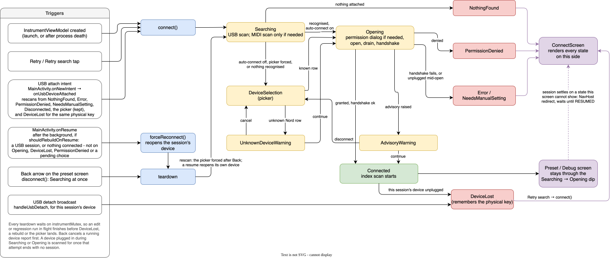

# Architecture

Patch Pilot is a native Android app for browsing, organizing and editing presets on supported hardware synthesizers over USB. It is a thin client: there is no server and no account system. The only state persisted across launches is the theme choice, the auto-connect preference and which instrument notices the user hid. A finished device report or regression report survives process death in saved state until it is dismissed or replaced; everything else lives on the connected instrument or in memory for the life of the process.

## Package layout

All source lives under `de.thewolfwalkexperience.software.patchpilot`.

| Package | Responsibility |
|---|---|
| `core/` | Device-agnostic domain model. The `Instrument` interface is the central abstraction the rest of the app is built around. Also `RegressionTester`, the facet-driven self-test behind the debug menu. |
| `transport/` | Byte-level I/O. `Transport` and its `AndroidUsbBulkTransport`, `AndroidMidiTransport` and `UsbMidiBulkTransport` implementations carry bytes with no protocol knowledge, so device code can be tested without hardware. |
| `midi/` | SysEx message framing (`SysExFramer`) and request/response correlation (`SysExExchange`), shared by the four families that speak SysEx (Pro-800, Motif XS, Axe-Fx III, Subsequent 37). `SysExExchange.pending` shows what has arrived of a message still being assembled, so a family can decode a slow reply while it arrives. |
| `discovery/` | Finds candidate instruments on the USB host bus and through Android's MIDI service, and merges them into one deduplicated list. |
| `catalog/` | Loads the per-family JSON device descriptors and maps a discovered device to the family implementation that handles it. |
| `devices/nord/`, `devices/pro800/`, `devices/motifxs/`, `devices/axefx3/`, `devices/subsequent37/` | One protocol implementation per device family, each adapting its wire protocol onto `core.Instrument`. |
| `demo/` | An in-memory instrument for exploring the UI without hardware. |
| `usb/` | Android USB host APIs: device enumeration, runtime permission and interface claiming. |
| `cache/` | An in-memory decorator that keeps a completed preset listing across the reconnects the app performs on every return to the foreground. |
| `ui/` | Jetpack Compose screens, navigation, and the session they share: one ViewModel over a connection coordinator and the preset listings. |
| `ui/theme/` | The theme system: Material 3 following the system setting, an alternate "Steampunk" skin, and the seam screens use to draw themselves differently per theme. |

## The `Instrument` abstraction

`core.Instrument` is an interface with a mandatory `browser` facet (list and re-read presets) and optional, nullable facets: `selector` (load a preset), `editor` (rename, move, swap, delete, copy), `transfer` (read a preset's raw data), `report` (a read-only device report) and `tagger` (categories and favorites). A family implements only the facets its instrument supports, and the UI checks for a facet's presence rather than catching an "unsupported operation" exception. Nullability makes the check and the capability the same piece of information: there is no separate capability set that could drift from what is implemented.

The abstraction sits above the wire-message level: the UI consumes "a list of named, addressable slots", not the shape of any device's messages. There is no shared message or plugin type across families. A CRC-framed bulk protocol (Nord), SysEx streams over class-compliant MIDI (Pro-800, Axe-Fx III, Subsequent 37) and a SysEx stream over raw bulk (Motif XS) have no useful common representation below the operation level.

Related types:

- `SlotAddress`: a canonical 0-based `(bank, slot)` pair, with a per-family `AddressFormat` responsible for rendering that family's own id shape (`A:1:1` on a Nord, `A00` on a Pro-800, `USER 1 - A:01` on a Motif XS). The UI never parses an id string itself; `PresetSlot` carries its display id and bank label. `LinearAddressFormat` serves an instrument with no banks at all: ids are one run of numbers (`000`–`511`), and the app groups them into virtual banks (`BankSpec.virtual`) only so the index rail has somewhere to jump; a virtual bank's header shows its number range without the word "Bank".
- `SlotLayout` and `BankSpec`: the instrument's addressable preset space. `BankSpec.readOnly` lives on the layout rather than on each row, so which addresses a copy may target and which rows offer an edit derive from one field.
- `IndexUpdate` and `Flow<IndexUpdate>`: listing is a stream, not a single suspending call, because the Pro-800 and the Motif XS have no directory and must be read slot by slot to learn each preset's name, and a Subsequent 37 sends its whole library as one message of about 142 seconds, whose programs are shown as its blocks arrive. Rows appear as they arrive; one unreadable slot is reported as `IndexUpdate.Failed` and does not abort the walk. `indexWalk` in `core/` is the shared loop.
- `InstrumentException`: a sealed hierarchy the UI branches on by type, never by message text. Every failure the instrument or the link causes is one of its subtypes, with the cause kept; a caller's bad argument is an `IllegalArgumentException` and is never mapped. `SlotStateChanged` says a slot is not as the list showed it (a preset stored or deleted on the panel since the last read), in the same words for every family. `PartlyApplied` says an edit changed the instrument and then stopped (a move that wrote its destination but could not empty its source), with why it stopped as its cause. `BlockedByDeviceState` carries an optional remedy the app can apply after asking (a Motif XS in Performance mode ignores a voice selection; the remedy switches it to Voice mode). `NeedsManualSetting` carries the steps for a fix only the user can make at the instrument's panel (a Motif XS routing MIDI to its DIN ports instead of USB).
- `InstrumentNotice`: something a family wants the user to know about how the app works with it, as opposed to `advisory`, which says something is wrong. `Instrument.notices` are shown in a dialog once the session is connected, once per app run, until the user ticks "Don't show this again"; `AppPreferences` (Preferences DataStore) remembers the hidden ids, and Settings clears them.
- `PresetTagger`: categories and favorites, shaped for both a Nord program (one category, no sub-categories, no favorites) and a Motif XS voice (two assignments of main plus sub-category, and a favorite mark that names which of them the instrument files the voice under).

## Transport and discovery

`transport.Transport` is the shared marker interface with two specializations: `UsbBulkTransport` (paired bulk endpoints plus the control pipe, implemented by `AndroidUsbBulkTransport`) and `MidiTransport` (a MIDI byte stream in and out, implemented by `AndroidMidiTransport` over `android.media.midi` and by `UsbMidiBulkTransport`, which packs USB-MIDI event packets by hand over a raw bulk endpoint for a device with no class-compliant MIDI interface). Device code depends only on these interfaces, so protocol logic is unit-tested against scripted fakes with no hardware or emulator.

`discovery.DeviceDiscovery` has one implementation per bus. `UsbHostDiscovery` matches USB vendor and product ids against the catalog. `MidiDiscovery` never matches on port name; it identifies a port by sending the read-only, idempotent probe the catalog declares and checking the reply. A message identical to the probe does not count: a virtual or loopback port sends back whatever it is sent, and the Axe-Fx III's reply prefix is the start of its own probe. `mergeCandidates` keeps one entry per physical device, USB host first, because a Nord also exposes a class-compliant MIDI interface that cannot manage presets.

`ConnectionCoordinator.performConnect` reads `AppPreferences.autoConnectToFirstFound` (Preferences DataStore, default true) on every scan. On, it scans the USB bus first and, if that alone found a recognised instrument, connects to it without running the MIDI scan at all: `mergeCandidates` prefers a USB candidate over a MIDI one for the same physical device, so the MIDI scan (which probes every port with a timeout of up to 600 ms each) could not change the outcome. Off, or where USB alone found nothing recognised, it runs the full two-bus scan and either connects to the first result or, with auto-connect off, stops at `ConnectionState.DeviceSelection` so the user picks explicitly.

## Catalog and adding a device family

Each family is described by one JSON file under `devices/`. `InstrumentRegistry` is a compile-time list of families, each of which loads its own catalog and builds its `Instrument` on an opened transport. The build copies the catalogs into the app's assets and generates the USB attach filter (`res/xml/device_filter.xml`) from their USB ids; [devices/README.md](../devices/README.md) describes both steps and the catalog formats.

Adding a device that speaks an already-implemented family's protocol is a catalog entry. Adding a new protocol is a new package under `devices/` implementing at least `Instrument.browser`, a new catalog file, and one entry in `InstrumentRegistry`.

`catalog.UnknownDevicePolicy` decides whether an unrecognized USB device may be opened on a guess against a known family's protocol. The families that allow it are a hardcoded set, currently the Nord family alone; the rule behind that choice is that a guess is only defensible where at least two verified members of the family share one protocol. The Pro-800, Motif XS, Axe-Fx III and Subsequent 37 families each have one verified member, which is no evidence about other instruments from the same vendor, so their vendor ids are refused. The vendor ids themselves are read from the catalog, so a new Nord model needs no change here.

### Nord family scope

Every supported Nord model (eight in the catalog) shares one implementation in `devices/nord/`: `NordDevice` speaks the wire protocol and `NordInstrument` adapts it onto `core.Instrument`. Per-model differences are catalog data: USB product id, bank/group/slot layout, name length and tested firmware versions. Two further values are read from the instrument at connect time rather than configured: the file-transfer protocol version, which selects the reply layouts, and each storage area's allocation unit. An unrecognized Nord starts with generous guessed bank bounds and replaces them with the bank count and capacity its own `Program` category reports.

## Caching

`cache.CachingBrowser` decorates a family's `PresetBrowser` and keeps a completed user listing in `PresetIndexCache`, keyed by instrument identity, firmware version, bank layout and the session's USB device path or MIDI device id, so a layout change invalidates the cache by construction. A physical replug does not reliably change the device path (on the hardware measured, Android hands the same port the same path again), so the cached listings are dropped on the USB detach broadcast instead, for whichever device it names, connected or not (`ConnectionCoordinator.handleUsbDetach`, which has `PresetListings` drop them by device path before any teardown): once the instrument has left the bus its contents may have changed from its own panel, or a different unit of the same model (which no family can tell apart, since none reads a serial number) may be plugged into the same port. The cache exists because the app rebuilds a USB session on every return to the foreground (`Instrument.rebuildOnResume`); without it a Motif XS would re-read all 416 user voices (about 93 seconds) every time the user switched apps. The cache is owned by `PresetListings`, which lives as long as the ViewModel, so it outlives the instrument object a reconnect replaces. No family knows it exists.

A listing is cached once it completed with no edit written through while it ran, since a row read before an overlapping edit would replay that edit undone. The addresses it could not read are cached beside its rows, and a replay reads only those again, so one slot that will not read does not cost every reconnect a full re-read (93 s on a Motif XS); one still unreadable is reported as such, never left out, since a missing row would read as an empty slot. An address whose read failed counts as neither free nor occupied: it is not offered as a copy or move destination, a drop onto it is refused, and the regression run does not use it as scratch. Only the user listing is cached: a factory listing is built from a shipped table and costs no round trips, and a favorites listing is exactly what changes behind the app's back when marks are set on the instrument's panel.

After an edit the listings are patched, not collected again: the edit re-reads every address it touched and writes the result through to the cache and into every listing holding that address, and the user listing gains an address it lacked. A listing is collected again only where a re-read failed or the edit dropped it (a favorite set or cleared), so an edit costs no full re-read.

The cache is never written to disk. There is no durable identity for a physical instrument across app restarts, and a decoder fix with no wire-protocol change would need a cache-invalidation trigger that does not exist.

## Preset scopes

`PresetBrowser` declares `scopes: List<PresetScope>` and takes one on `index(scope)`. `USER` is the default and the only scope most families offer, so their screens show no selector. The Motif XS adds `FACTORY`, its eleven read-only banks named from `devices/motifxs_factory_voices.json` with no device I/O, and `FAVORITES`, the marks the instrument holds across factory and user banks, read from a per-bank table (see [PROTOCOLS.md](PROTOCOLS.md)).

`PresetListings` keeps one listing state and one collector job per scope rather than re-collecting on every switch, because two questions cross scopes: a copy's destinations are the free user slots even while the factory listing is displayed, and an edit made from the favorites listing changes a row the user listing also holds.

## UI and concurrency

The UI is Jetpack Compose with Navigation Compose across a fixed set of routes: connect, programs, settings, the open-source licence screens, and a hidden debug screen reached by five taps on the instrument name. One `InstrumentViewModel` holds the session for the app's lifetime, in three parts:

- `ConnectionCoordinator` owns the connected `Instrument` and the `StateFlow<ConnectionState>`: scanning, opening, the unknown-device and advisory gates, USB attach and detach, and teardown. It takes the USB host (`UsbHost`), the buses, the catalog and the instrument factories as parameters.
- `PresetListings` owns the per-scope listings, the listing cache, and the re-reads after an edit.
- The ViewModel routes the screens' operations through the instrument's facets and derives `SessionCapabilities`, what the screens read about the session, once per connection state. It also holds the preset screen's `ProgramsController`, so a rotation or a trip to Settings mid-edit keeps the busy line, the result and an open dialog; the controller is reset when the user leaves the session, the device is lost, or another instrument's session begins.

The ViewModel constructs `UsbConnectionManager` and the discoveries and hands them to the coordinator; there is no dependency injection. A family that may be opened on a guess builds that instrument itself (`InstrumentFamily.createForUnknown`), and a family-specific check the debug menu offers is a facet (`Instrument.factoryNames`), so nothing above the instrument layer names a family.

Long-running work is placed by lifetime:

- Listings run in `viewModelScope`, so they survive rotation and are cancelled when the session is torn down. The teardown waits for a cancelled listing's cleanup before closing the connection: a Nord listing sends its category unlock from a `NonCancellable` section, and a closed connection would leave that lock set.
- Edits also run in `viewModelScope` (`launchEdit`), not in the screen's composition scope, so navigating away cannot abandon a write mid-sequence. A Motif XS left in the middle of a block sequence shows "receiving midi bulk data"; the unit measured recovered on its own, but whether every unit does is unconfirmed, so the send loop of a block sequence additionally runs under `NonCancellable`, as do the write-plus-commit of every Motif XS edit and the cleanup that releases a Nord's category lock. The debug menu's regression test, which also writes, runs in `RegressionRunner` under the ViewModel for the same reason, with its confirmation questions exposed as state the debug screen answers; a finished report is kept in `SavedStateHandle`.
- Device reports run in `DeviceReportRunner` under the ViewModel as well, and a finished report is held in `SavedStateHandle` until it is dismissed or replaced: the read only queries, but on a Nord it takes minutes, which is worth keeping across a rotation. The file name a share from the preset or connect screen was asked for is held there too (`DeviceReportRunner.shareAs`), so a rotation between the tap and the end of the read still shares it; that share dismisses the report once the share sheet is up, while the debug menu keeps it for Share and Save. The debug menu's factory-name check is the one long read left in the screen's composition scope; a rotation cancels it and it starts over.
- Every `catch` in the UI and device layers rethrows `CancellationException` before handling anything else, so backing out of an operation is never reported as a failure.
- The coordinator's operation mutex (`ConnectionCoordinator.exclusive`) serializes edits, reports and the regression test against session teardown, so a resume that rebuilds the session waits for an edit in flight rather than closing the transport under it. Listings are deliberately not under this mutex; teardown cancels them under it and waits only for their cleanup. Each family serializes its own bus below that: `SysExExchange` holds a lock per request/reply, and `NordInstrument` holds one per operation, since a Nord operation is a request sequence inside a category lock that must not interleave with a listing. `AxeFx3Instrument` does the same for the same reason: every Axe-Fx III write is select, transfer, store, and a listing's name query must not land between the select and the store. Its transfer steps are sent with no retry (`SysExExchange.exchange`'s per-call `retries = 0`), since a re-sent chunk would land in the transfer twice, and its select-to-store sequence runs under `NonCancellable`, since stopping between chunks would leave the loaded preset's edit buffer half-written. `Subsequent37Instrument` holds its lock for a whole listing, since the instrument answers nothing else while it sends its 142-second dump; every other operation refuses at once with `BlockedByDeviceState` rather than wait behind it. Its multi-write edits (move, swap) are `core.ComposedEditor`'s, shared with the Pro-800 and the Axe-Fx III: they run under `NonCancellable`, so a cancelled move or swap finishes rather than leaving one preset in two slots; a swap puts the first slot back if either write fails, and a move whose erase fails says the preset is now in both slots.
- A connect attempt that fails after the transport is open (a handshake timeout, a Motif XS routed away from USB, the user backing out) closes the transport before reporting, so a MIDI port or USB interface is never left claimed by a session that does not exist.

All blocking I/O runs on `Dispatchers.IO`: `NordDevice` wraps every request, the SysEx transports read on a dedicated `Dispatchers.IO` scope (`transportScope`), and `MidiTransport.send` is a suspending call that moves the write there too.

### USB session lifecycle

How a session is found, opened, lost and found again, and which screen shows each state. Every box on the right is a `ConnectionState`; the triggers on the left are the only things that start a connect attempt.

<!-- Source: usb_session.drawio. Re-export after editing with
     /Applications/draw.io.app/Contents/MacOS/draw.io -x -f svg -e -o docs/usb_session.svg docs/usb_session.drawio
     (-e embeds the diagram, so the SVG itself reopens in draw.io). -->

The rules that keep this honest:

- **A connect attempt is single-flight.** `connect()`, `forceReconnect()` and the attach-intent path all go through the same guard, so the triggers can overlap (a USB attach that also resumes the activity, say) without two scans racing for the same interface. `disconnect()` is the one exception: it cancels the attempt in flight and runs after it, so a resume's reconnect cannot undo a Back press.
- **A device plugged in mid-scan is not missed.** An attach during `Searching` or `Opening` is remembered, and once that attempt ends without a session the coordinator scans again: the device may have enumerated after the scan's USB phase.
- **A physical detach drops the cached listing; a resume keeps it.** `DeviceLost` is the boundary `PresetIndexCache` honours, and the detach broadcast is the one reliable sign of it (see "Caching"). The `Searching → Opening → Connected` dip of a `forceReconnect()` crosses no such boundary, which is what the cache exists to survive.
- **An unplug shows at once.** `handleUsbDetach` publishes `DeviceLost` before the teardown, which waits for the operation mutex, and cancels a running device report or regression run, which can only fail now; the next connect attempt waits for that teardown, so a replug cannot be ignored as an attach during a session or have its new instrument closed by the old teardown.
- **A permission request always settles.** `awaitPermission` ends the wait when the answer arrives, when the grant arrives without one (the dialog Android shows on attach grants it too), or after a minute, which lands on `PermissionDenied`. From there Retry asks about the same device and "Show all devices" offers the picker.
- **The first attempt starts with the ViewModel, not with a screen.** After process death the restored back stack can start on the preset screen, which never asks to connect. `Disconnected` is only the moment before that first attempt.
- **Backing out lands on the picker, never on a bare "Not connected".** Back on the preset screen and Disconnect on the advisory gate both run `disconnect()`. It publishes `Searching` at once, cancels a running device report (read-only, and minutes long on a Nord), tears the session down once the operation mutex is free, and rescans with the picker forced, so auto-connect cannot reopen the same instrument and raise the same advisory again. Cancelling the unknown-device warning returns to `DeviceSelection` directly.
- **A resume reopens the session's own device.** `forceReconnect()` finds the device the session was opened on again by its handle, or by model where only one unit is attached, and offers the picker if it is gone; it never switches to another attached instrument. An advisory the user accepted is not raised again by a resume; `disconnect()` and a detach forget it.
- **A scan that a resume would throw away is cancelled on pause.** `MainActivity.onPause` calls `onAppBackgrounded()`, which stops a running index scan only where `shouldRebuildOnResume` is true, the same answer that makes the resume tear the session down and discard the scan, and not while a regression run is going: the run reads the user listing, and a cancelled listing would make it read every slot again in the background. Letting it run would only keep the instrument busy for nobody; on a Motif XS that is its own display on "dump in progress" for up to 93 s with the phone locked. A session over `MidiManager` (Pro-800, Axe-Fx III, Subsequent 37) does not rebuild on resume, so its scan keeps running in the background and is complete when the app returns. An edit, report or regression run is never cancelled this way: it holds the operation mutex, and the resume's teardown waits for it.
- **A resume rebuilds only after a stay in the background.** The ViewModel holds that flag (`onAppBackgrounded`, `onAppForegrounded`), so a launch or a rotation does not rebuild, and a recreation while backgrounded still does.
- **A resume never re-asks a question the user just answered, or answers one for them.** `shouldRebuildOnResume` is false while `Opening` (the permission dialog may still be up) and on `PermissionDenied` (its dismissal is itself a resume); either would otherwise put the dialog straight back up. It is false on `DeviceSelection` and `UnknownDeviceWarning` too, where auto-connect would make the user's choice for them.
- **System back on the preset screen does what the arrow does.** Both end a destination pick first, as its Cancel does, else leave for the picker, and are refused while an edit runs. System back never reaches the activity, which would close the session on Android 8 to 11.
- **Both hand-offs between `ConnectScreen` and the session screens wait for the current entry to be RESUMED.** `PatchPilotApp` watches the connection state: it leaves the preset and debug routes once the state settles somewhere those screens cannot render, and leaves `ConnectScreen` for the preset list once a session is connected. A navigate fired while the entry is not resumed (under a system dialog, in the background, behind the lock screen, or in the first frame of a pop transition) is dropped by the transition guard, and nothing would re-run it, so both effects suspend on `withResumed` instead of trying once. An instrument plugged in while the phone is locked connects in exactly that state.
- **The connection is never closed under an edit.** `ConnectionCoordinator.release()`, which `onCleared()` calls, takes the operation mutex and stops the listings before closing the instrument; where an edit's `NonCancellable` section still holds the mutex, or a cancelled listing is still cleaning up, the close is deferred until that has finished.

## Theming

`AppTheme` is a two-value enum: `Default` (Material 3, following the system light/dark setting, with dynamic colour on API 31 and later) and `Steampunk` (a fixed dark look that does not follow the system setting). The choice is persisted by `AppPreferences` (Preferences DataStore), stored by enum name so an unrecognized value falls back to `Default`. Every stored setting goes through `AppPreferences`: a store that cannot be read reads as its defaults, and a write runs on the ViewModel's scope, so leaving Settings does not cancel it.

`PatchPilotTheme` maps the active `AppTheme` to a colour scheme, typography and shapes and wraps the app in one `MaterialTheme`, so stock Material components pick up the swap. Bespoke drawing that tokens cannot express (a compass in place of the progress indicator, a brass screen frame, a brass drag handle) lives behind the `ThemeStyle` interface, provided as `LocalThemeStyle`. Screens read `LocalThemeStyle.current` and never branch on `AppTheme` directly, so a third theme is one `ThemeStyle` implementation plus a mapping in `AppTheme.style`.

`MaterialTheme` and the navigation host are composed from exactly one call site, never once per branch of a `when (appTheme)`. Two call sites would give the content two positions in the composition, and switching themes would then tear the whole subtree down, including the navigation controller and its back stack.

## Demo mode

`demo.DemoInstrument` implements `core.Instrument` directly against an in-memory `DemoLibrary` rather than simulating wire bytes through a fake transport, so there is no second fake wire protocol to maintain for the sake of the UI. It is shaped like a Nord: grouped addressing, one category per preset, native edits, no favorites.

## Testing

The test suite is JVM unit tests. Most run against the stubbed Android SDK jar (`isReturnDefaultValues = true`); the few that need the framework run on Robolectric, at SDK 35 (`robolectric.properties`: SDK 36 needs Java 21). There are no instrumented tests. Device protocol tests run against fake transports. `ReplayTransport` (Nord) and `FakeMidiTransport` serve fixed request/response pairs and assert message ordering; `ReplayTransport` also fails a test whose script is out of step or not used up, rather than letting the code under test handle that as a device failure. `FakeNordTransport`, `FakePro800`, `FakeMotifXs`, `FakeAxeFx3` and `FakeSubsequent37` answer the way the instrument does and keep its presets, so a write can be read back. Fixture byte sequences are captured from instruments or hand-written to cover documented edge cases rather than generated by the code under test, so a failure reflects a decoding defect rather than an encoder and decoder agreeing by construction.

`ProgramsController` holds the preset screen's operation logic behind the `ProgramsOperations` interface so it can be tested without an `Application` or a session. `ConnectionCoordinatorTest` drives the connection state machine against fake buses: what a USB detach does in each state, the unknown-device and advisory gates, leaving a session, and the resume rebuild. The same seam shape makes two more pieces testable: `MidiDiscoveryTest` runs the MIDI scan against fake ports (`MidiPorts`), and `ProgramListDragStateTest` runs the drag-to-reorder state against a fake list (`DragListViewport`), since that gesture cannot be driven over adb. `InstrumentViewModelTest` runs the ViewModel on Robolectric for the decisions it makes itself (the first connect, the resume rebuild), and `PresetScreenLifecycleTest` drives the real screens in demo mode through Compose UI tests: leaving the preset screen, and recreating the activity, while an operation holds the instrument. Everything else it decides lives in the units it is built from, and other decisions worth testing in isolation (`UnknownDevicePolicy`, `PresetIndexState`) are standalone units too. `CatalogParsesTest` decodes the real catalog files from `devices/`, which the build hands to the tests as a system property and declares as a task input, and checks the generated USB device filter against them.

## Known limitations

- No dependency injection; the ViewModel constructs its dependencies directly.
- The app manages exactly one connected instrument at a time. Two instruments of the same model connected at once collapse to one candidate, because the physical key is the USB vendor and product id; for the same reason, unplugging the idle one of the two ends the session on the other as `DeviceLost`. No family reads a serial number that would tell them apart.
- No on-disk persistence of the preset listing.
- No instrumented tests. The Compose UI tests run on Robolectric, in demo mode only.
